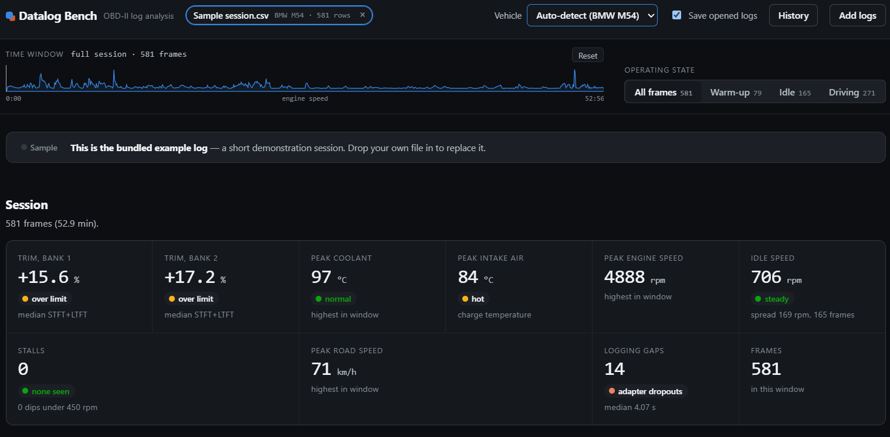
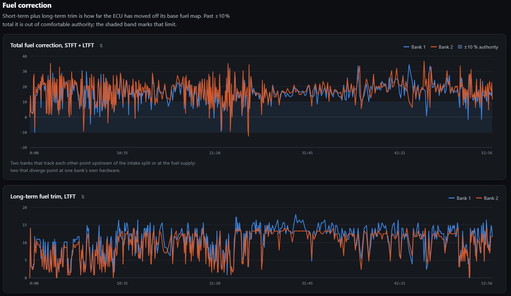
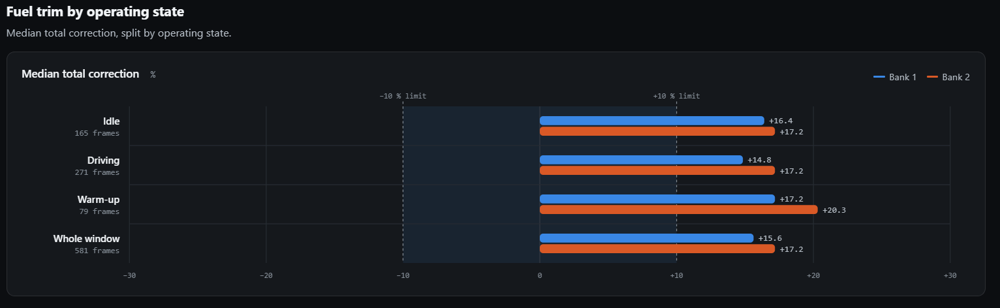
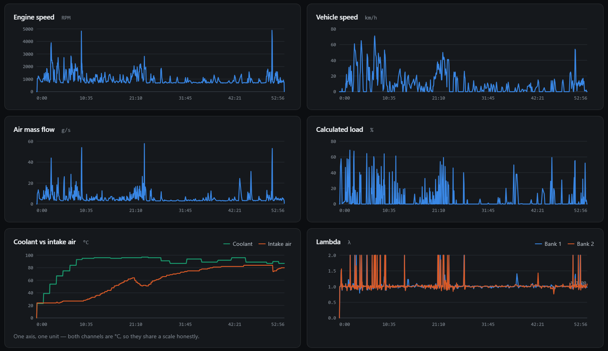

<h1 align="center">Datalog Bench</h1>

  A browser-based analyser for OBD-II and EvoScan datalogs. 
  Fuel trims, engine channels and operating-state breakdowns on a shared time axis, 
  with a saved history for side-by-side comparison of sessions.

  
  
  

  

Datalog Bench reads CSV logs from the BMW M54 and the Chevrolet L59 (5.3 L V8),
recorded with OBD Fusion over an ELM327 adapter, and from the Mitsubishi Lancer
Evolution (4G63T), recorded with EvoScan. Drop in one or more logs to see fuel
trims and engine channels on a shared time axis, check them against
engine-specific rules, and keep a history of past sessions to compare.

It reads standard OBD-II / EOBD data, plus EvoScan MUT items for the Evo.

## Quick start

    docker compose up -d --build

Then open <http://localhost:8080>. A built-in sample session loads on first
visit. See [Running it](#running-it) for details, including how to use the app
without Docker.

## Screenshots

The dashboard above shows the session summary: median trim per bank, peak
temperatures and speeds, idle speed, stalls and logging gaps, each tagged
against the active vehicle profile's limits. Drag on the timeline to select a
window, and filter frames by operating state.

### Fuel correction

Total correction (short-term plus long-term trim) with the ±10 % band marked,
followed by separate long-term and short-term charts for both banks.

### Trim by operating state

Median total correction split by warm-up, idle and driving, on a fixed
−30 to +30 % axis. This shows whether a trim problem appears at idle, under
load, or both.

### Channels

Every channel on one time axis with a shared crosshair. Hover or use the arrow
keys to step through frames.

## Features

- **Log intake.** Drag and drop or choose one or more CSV files. The parser
  detects the delimiter and decimal separator, matches column headers to known
  channels, and converts imperial units (°F, mph, lb/min) to metric. A
  built-in sample log is included.
- **Channels read.** Engine speed, road speed, calculated and absolute load, MAF,
  ignition advance, coolant and intake air temperature, short- and long-term
  trim per bank, wideband lambda per bank, and elapsed time (a timestamp column
  is used only when there is no elapsed-time column). Also read, for the L59
  checks: throttle position, manifold pressure (psi and inHg are converted to
  kPa), fuel system status, O2 voltage per bank for the front (sensor 1) and
  rear (sensor 2) sensors, and knock retard. GPS, ambient and oil temperature
  and module voltage are deliberately not mapped. "Idle" is road speed 0, or
  under 1200 rpm when the log has no road speed; when there is no road speed
  but there is a throttle channel, idle is taken from the log's own
  closed-throttle level, since absolute throttle position does not read 0 % at
  idle.
- **Vehicle profiles.** Every engine-dependent limit (idle and stall rpm, idle
  hunting spread, coolant, intake air and trim limits) lives in a profile, `m54`,
  `l59` or `evo` (`PROFILES` in `src/02-parse.js`). Choose the car in the
  **Vehicle** menu in the app bar, or on the cards shown when no log is open.
  The choice applies to the open log and to every log added after it, and is
  remembered in this browser. On **Auto-detect** the profile is picked from the
  log: an EvoScan file means the Evo; manifold pressure, narrow-band O2 voltage on
  sensor 1, knock retard or an L59-style file name point to the L59; wideband
  lambda points to the M54. "Parse and channels" says which profile is active and
  why. The choice is not saved with a log in History. The M54 profile holds the
  limits the app shipped with. The L59 and Evo values are starting estimates and
  need tuning against real logs.
- **Mitsubishi Evo (EvoScan).** EvoScan CSVs from a 4G63T Evo I–IX are
  recognised by their `LogID`/`LogEntryDate`/`LogEntrySeconds` columns, and the
  MUT item names (`CoolantTemp`, `TimingAdv`, `Load1B`, `KnockSum`, `AirFlow`,
  `InjDutyCycle`, `Battery`, ...) are mapped. EvoScan headers carry no units, so
  they are read off the data: coolant above 135 for a tenth of the log means °F,
  and a speed column in 1.2427 mph steps (the ECU's 2 km/h step) means mph. Trims
  that read exactly zero in every frame are not analysed as trims; a warning
  finding says the zeros mean either the trims are not really read or the ECU
  never entered closed loop, and asks for `O2Sensor` to tell them apart (this
  applies to every profile). Evo checks: knock sum, injector duty, charging
  voltage, and timing under load (load 120+, 1500–4500 rpm), which warns when
  timing sits near zero without knock to explain it and names the two causes
  (a mismatched timing formula in EvoScan, or the low-octane map; `OctaneFlag`
  is read when logged). Front O2 switching runs when `O2Sensor` is logged. On EvoScan logs a stationary car with the throttle open
  is a free rev, not idle, and a dip in rpm across a pause in logging of 60 s or
  more is counted as a key-off rather than a stall.
- **L59 checks.** With the L59 profile, these run when their channels exist:
  throttle plausibility, idle manifold vacuum, airflow against manifold
  pressure times rpm, front O2 sensor switching (stuck or lazy sensors, bank
  gap), closed-loop time while warm, and knock retard. Knock retard is not a
  standard OBD-II PID and only appears if you add a GM enhanced PID in OBD Fusion;
  without it a sudden-timing-drop check runs and is labelled "inferred". These
  rules do not run on the M54 profile.
- **Constant-zero channels.** A coolant, intake air, MAF, lambda or rpm column
  that reads 0 for the whole log is dropped with a warning: the PID is
  unsupported or the sensor is unplugged.
- **Channel mapping.** If a column is not recognised, map it to a channel by
  hand. The parse report lists skipped lines, ragged rows and unit conversions.
- **Summary tiles.** Median fuel trim per bank, peak coolant and intake air
  temperature, peak engine and road speed, idle speed and stalls, logging gaps and
  frame count, limited to the channels the log has. A short last row stretches
  to the full width.
- **Idle speed and stalls.** Idle speed is the median rpm over warm idle frames;
  it is flagged "hunting" when the spread (standard deviation) exceeds 250 rpm
  (`IDLE_HUNT_SD` in `src/06-shell.js`). Without road speed, idle includes
  coasting, so a healthy idle measures about 140-180 rpm. A dip is a stretch
  under 450 rpm after the engine first ran above 600 rpm; a stall is a dip
  that reaches 0. Cranking and the key-off tail are not counted, and slow
  channel refresh can hide short dips, so the counts are minimums.
- **Fuel correction charts.** Total fuel correction (STFT + LTFT) with a ±10 %
  band, then separate long-term and short-term trim charts, each with both
  banks.
- **Time-aligned panels.** Every channel on one time axis with a shared
  crosshair. Hover or use the arrow keys to step through frames; the readout
  shows the full frame at the cursor.
- **Window and state filters.** Drag on the timeline to select a window. Filter
  frames by operating state: all frames, warm-up, idle or driving.
- **Map and terrain.** The parser no longer maps GPS columns, so this section
  stays hidden. The drawing code and the `tiles` service are kept for now.
- **Trim by operating state.** Median total correction split by warm-up, idle
  and driving, on a fixed −30 to +30 % axis with the ±10 % band marked.
- **Sample interval chart.** Shows logging gaps so you can tell which readings
  may be artefacts of a dropped capture.
- **Table view.** Every source column for every frame in the current window.
- **History.** Optional and off by default. Turn on "Save opened logs" (or press
  "Save this log") to keep sessions on the server, with duplicate detection by
  content hash. Reopen or delete any saved session from the History panel, and
  add a free-text note to each (for example "AC on", "used OEM MAF fitted").
  The stored headline is computed at upload and is not recomputed when the
  rules change.
- **Compare.** Select two to four saved sessions for a side-by-side table:
  session notes, idle and driving trim per bank, idle speed and stalls, peak
  temperatures, trim-versus-intake-air slope at warm idle, logging cadence, units,
  and which checks each log was too sparse to run.

## Running it

The stack runs in Docker Compose:

    docker compose up -d --build

Then open <http://localhost:8080>.

| Service | Role | Port |
|---|---|---|
| `web` | The app, served by nginx (non-root, read-only filesystem) | 127.0.0.1:8080 |
| `tiles` | Caching proxy for satellite map imagery | internal |
| `db` | Stores saved logs in SQLite on a named volume (`db-data`) | internal |

`web` proxies `/tiles/` and `/api/` to the other two services, so the browser
only talks to one origin. Stop the stack with `docker compose down`; the
`db-data` volume keeps your history across restarts (`docker compose down -v`
deletes it).

The port is bound to loopback only. **The history API has no authentication.**
To reach it from another machine, change the bind address in `compose.yaml`, and
only do that on a network you trust or behind your own authenticating reverse
proxy.

To use the app without Docker, build the single HTML file and open it in a
browser:

    python build.py        # writes dist/Datalog-Bench.html

Without the `db` service there is no history or Compare, and without `tiles`
the map has no satellite imagery. Analysis of the open log still works.

## History API

`web` serves the `db` service under `/api/`:

| Method | Path | Does |
|---|---|---|
| `GET` | `/api/logs` | List saved logs, newest session first, with `note` |
| `POST` | `/api/logs` | Save `{name, text}`; a duplicate by content hash returns the existing id |
| `GET` | `/api/logs/:id/raw` | The stored CSV, byte for byte |
| `PATCH` | `/api/logs/:id` | Set `{note}` (control characters stripped, 500 characters max; empty clears) |
| `DELETE` | `/api/logs/:id` | Remove a log |

The `note` column is added to an existing database on start-up.

## Privacy

- Analysis runs in your browser. Nothing is uploaded unless you turn on "Save
  opened logs" or press "Save this log". Saved logs go to the `db` service of
  your own stack.
- Logs can contain GPS positions. Keep the stack on a trusted network, and
  delete saved logs you no longer need from the History panel.
- Satellite imagery is off by default. When you switch it on, the tile requests
  for your route's area go through the `tiles` service to Esri World Imagery, so
  Esri can see that area. The vector basemap makes no external requests.
- The page loads no third-party scripts, fonts or analytics.

## Development

    src/                 six numbered parts, concatenated in filename order
      01-shell.html      styles, page skeleton, empty state, history panel
      02-parse.js        channel spec, engine profiles, parser, unit normalisation
      03-analyze.js      analysis rules and per-session metrics
      04-render.js       chart engine, panels, crosshair, readout
      05-map.js          map projection, tile layer, event markers
      06-shell.js        summary tiles, mapping UI, file intake, history, compare
    db/                  history API (node:http + node:sqlite)
    docker/              nginx configs and the tiles proxy image
    test/                golden tests, parser edge cases, profile tests, db tests
    .github/workflows/   CI: tests, build gate, Docker image build
    fixtures/            sample inputs for the tests (GPS columns removed);
                         L59_*.csv are synthetic, see fixtures/README.md
    make-l59-fixtures.py generates the synthetic L59 fixtures (seeded)
    build.py             assembler and structural checks

The parts share one scope, so keep the filename order and keep everything
inside the single `(function () { ... })()` that `01-shell.html` opens and
`06-shell.js` closes.

Build and test:

    python build.py            # assemble dist/Datalog-Bench.html and run the checks
    python build.py --check    # validate only
    npm test                   # golden tests over fixtures, plus parser edge cases
    node test/run.mjs --update # rewrite golden files after an intentional change
                               # (review the git diff of test/golden/ before committing)
    npm run test:db            # history service tests

Requirements: Node 22.5 or later (the history service uses `node:sqlite`),
Python 3, and Docker for the compose stack.

`build.py` fails if the assembled page has unbalanced HTML, a missing
placeholder, the wrong number of `<script>` elements, or a JavaScript syntax
error (`node --check`). Each Docker image build runs these checks and its test
suite, and fails if either fails. The only runtime requirement is a browser;
Python, Node and Docker are needed for building and testing only.

## Contributing

Contributions are welcome. Run `npm test`, `npm run test:db` and `python3
build.py` before opening a pull request; CI runs the same checks. Do not add
your own logs to `fixtures/`, because they can contain GPS positions.

Saved-log limits can be tuned with environment variables on the `db` service:
`MAX_LOGS` (default 500) caps how many logs it will store.

## License

MIT. See `LICENSE`. You may use, copy, modify and redistribute this software
freely, including commercially.
